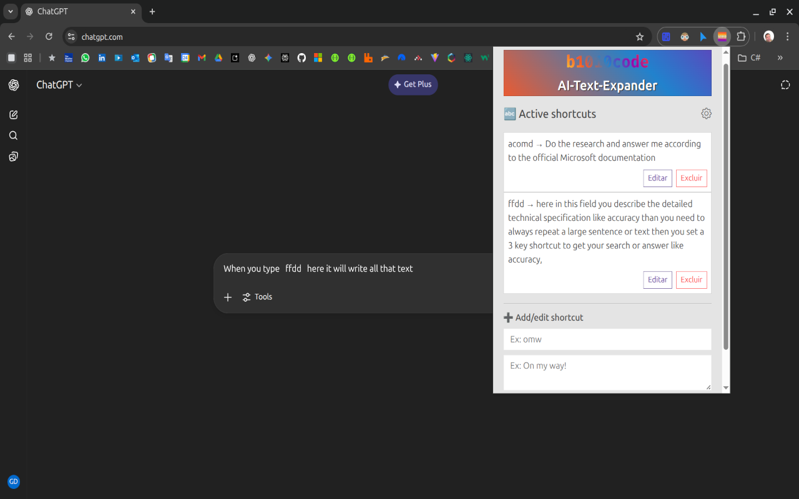
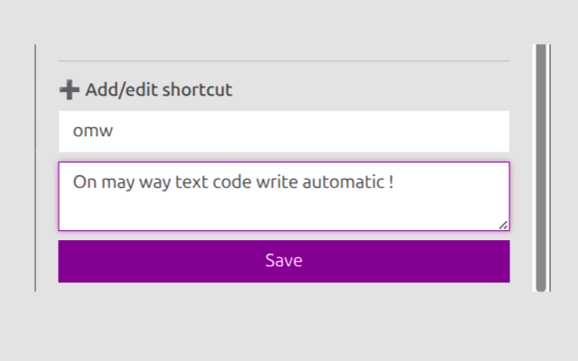

ChatGPText expander para I.As - Extensão para Google Chrome

chatgpt.com, chat.openai.com, gemini.google.com, you.com, google.com, google.com, google.com.br, copilot.microsoft.com, bing.com, claude.ai, claude.ai, huggingface.co, poe.com, bard.google.com

- Exemplo de uso :
    
  

- Exemplo de como adicionar ou editar um text-expander :
    
  
